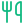

# Soultone, alias Deusexi 

**Technicien en conception logicielle** ·  Bénin

Je construis des APIs, des assistants IA et des outils qui automatisent le travail répétitif. 
J’aime partir d’un besoin concret et en faire un outil qu’on peut utiliser.

---

##  En ce moment

- **Backend & IA appliquée** : je conçois des APIs et des systèmes IA/RAG, avec Python et FastAPI au cœur de ma stack.
- **Freelance** : je développe et déploie des solutions adaptées aux besoins de mes clients.
- **Exploration** : automatisation et entrepreneuriat tech, avec l’envie de transformer des idées en projets utiles.

 Titulaire d’une **Licence en Architecture Logicielle à ESGIS-Bénin**.

---

##  Projet phare : Pilote AI

<table>
<tr>
<td>

### Un assistant IA pour le pilotage de projets

Réalisé seul lors de mon stage chez **Upsilon Consulting**, Pilote AI aide à exploiter les documents d’un projet pour en suivre l’avancement et préparer les décisions.

-  Analyse documentaire et synthèses pour les comités de pilotage.
-  Identification des risques et suivi des indicateurs clés.
-  Chat IA pour interroger les informations du projet.
-  Anonymisation des documents avant leur envoi au modèle.
-  Backend FastAPI, interface React et configuration de déploiement Docker / Caddy.

**Stack :** Python · FastAPI · React · Llama via Groq · Docker

**État :** prototype fonctionnel exécuté en local.

[Explorer le code →](https://github.com/Soultone-hub/agent-ai-pmo) · [Configuration de déploiement →](https://github.com/Soultone-hub/agent-ia-pmo-deploy) · [Étude de cas →](https://deusexi.vercel.app/projets/pilote-ai)

</td>
</tr>
</table>

---

##  Ma stack

  <strong>Backend, données & déploiement</strong>  
    
  <strong>Interfaces & applications web</strong>  
  

Également dans mes projets : Django REST Framework · RAG · Llama / Groq · Docker Compose · Caddy

---

##  Autres projets

| Projet | En bref | Technologies |
| :--- | :--- | :--- |
|  [GymHack](https://github.com/Soultone-hub/GymHack) · [Essayer ↗](https://gymhack.pages.dev/) | Une PWA de fitness avec exercices animés, favoris et séances personnalisées. | React · Supabase · Cloudflare Workers |
|  [LogAnalyzer Pro](https://github.com/Soultone-hub/loganalyzer) | Un outil CLI pour filtrer les logs, produire des statistiques et générer des rapports JSON. | Python |
|  [Food Finder API](https://github.com/Soultone-hub/Food_Finder_API) | Une API de découverte de restaurants, avec authentification et profils vendeurs. | Django · DRF · SQLite |
|  [Sunem](https://github.com/Soultone-hub/Sunem) | Une boutique en ligne dédiée au pagne africain. | Laravel · PHP · Vite |

[Voir tous mes dépôts →](https://github.com/Soultone-hub?tab=repositories)

---

##  Activité GitHub

  

---

###  Un projet à construire ensemble ?

**Disponible pour des missions freelance et des collaborations.**

[Mon portfolio](https://deusexi.vercel.app) · [M’écrire](mailto:amoussasoultone0@gmail.com)

Hors terminal :  jeux vidéo ·  cuisine ·  bricolage ·  lecture

